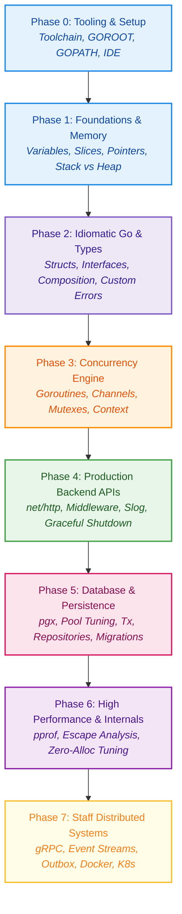
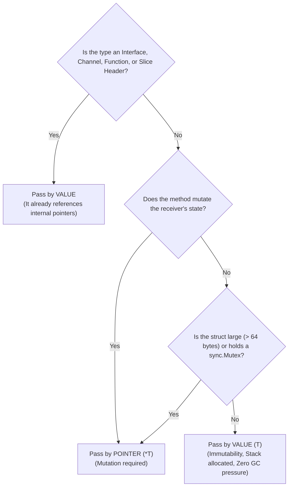

<div align="center">

# 🐹 Go Language Mastery & Production Engineering Roadmap

### _From Basic Syntax to Principal Systems Engineer_

<!-- Level 1: Core Toolchain & Fundamentals (Junior) -->

<a href="https://go.dev"></a>
<a href="https://pkg.go.dev/std"></a>
<a href="https://golangci-lint.run"></a>
<a href="#-quickstart--running-scripts"></a>
<a href="#phase-03--concurrency--runtime-internals-the-engine-room"></a>
<a href="#phase-03--concurrency--runtime-internals-the-engine-room"></a>
<a href="https://go.dev/doc/articles/race_detector"></a>
<a href="https://github.com/jackc/pgx"></a>
<a href="https://sqlc.dev"></a>
<a href="https://redis.io"></a>
<a href="#phase-06--high-performance-profiling--zero-allocation"></a>
<a href="#phase-06--high-performance-profiling--zero-allocation"></a>
<a href="https://grpc.io"></a>
<a href="https://www.docker.com"></a>
<a href="https://prometheus.io"></a>

<p align="center">
  <b>Authored by a Principal / Staff Engineer & Senior Technical Instructor</b><br>
  <i>"No decorative fluff. Only the exact tools, compiler internals, and runtimes used in Go engineering from day 1 syntax to planetary scale."</i>
</p>

[⚡ Quickstart & Runner](#-quickstart--running-scripts) •
[🗺️ Learning Roadmap](#-the-master-learning-roadmap) •
[📊 Career Progression Matrix](#-career-progression-matrix-junior-to-principal) •
[🧠 Core Mental Models](#-principal-engineer-mental-models) •
[📜 Production Commandments](#-the-10-production-commandments)

---

</div>

## 📑 Table of Contents

- [🎯 Engineering Philosophy & Objective](#-engineering-philosophy--objective)
- [⚡ Quickstart & Running Scripts](#-quickstart--running-scripts)
  - [1. Windows Automated Runner (PowerShell)](#1-windows-automated-runner-powershell)
  - [2. Unix / macOS / WSL Runner (Make)](#2-unix--macos--wsl-runner-make)
  - [3. Native Go CLI One-Liners](#3-native-go-cli-one-liners)
  - [4. Hot Reloading with Air](#4-hot-reloading-with-air)
- [🗺️ The Master Learning Roadmap (Zero to Staff Engineer)](#-the-master-learning-roadmap)
  - [Visual Learning Progression](#visual-learning-progression)
  - [📊 Career Progression Matrix (Junior to Principal)](#-career-progression-matrix-junior-to-principal)
  - [Phase 00 — Tooling & First Hour](#phase-00--tooling--the-first-hour-developer-environment)
  - [Phase 01 — Language Foundations](#phase-01--language-foundations--memory-fundamentals)
  - [Phase 02 — Idiomatic Go & Object Composition](#phase-02--idiomatic-go-structs--interfaces)
  - [Phase 03 — Concurrency & Go Runtime Internals](#phase-03--concurrency--runtime-internals-the-engine-room)
  - [Phase 04 — Production Backend APIs & Services](#phase-04--production-backend-apis--web-services)
  - [Phase 05 — Database Engineering & Persistence](#phase-05--database-engineering--persistence-layer)
  - [Phase 06 — High Performance, Profiling & Memory Tuning](#phase-06--high-performance-profiling--zero-allocation)
  - [Phase 07 — Distributed Systems & Microservices](#phase-07--distributed-systems-resilience--cloud-native)
- [📁 Repository Architecture](#-repository-architecture)
- [🧠 Principal Engineer Mental Models](#-principal-engineer-mental-models)
- [📜 The 10 Production Commandments](#-the-10-production-commandments)
- [🛠️ Recommended Production Ecosystem](#-recommended-production-ecosystem)
- [🤝 How to Track Your Journey](#-how-to-track-your-journey)

---

## 🎯 Engineering Philosophy & Objective

Go (Golang) was engineered at Google to solve real software engineering challenges at planetary scale: **slow builds, complex dependency trees, uncontrolled memory usage, and bloated OOP hierarchies**.

This repository is built for developers who want to move past superficial tutorial examples and learn how **Staff and Principal Engineers write production-grade Go**:

| ❌ What We Do NOT Do                          | ✅ What This Repository Teaches                                        |
| :-------------------------------------------- | :--------------------------------------------------------------------- |
| Shallow 10-line syntax snippets               | Deep dive into stack vs. heap escape analysis                          |
| Ignoring errors or using `panic`              | Idiomatic sentinel errors, wrapping, and error taxonomy                |
| Uncontrolled Goroutine spawning (`go func()`) | Channel coordination, worker pools, and leak-free lifecycles           |
| Naive slow `OFFSET` SQL queries               | High-concurrency connection pools, keyset pagination, and transactions |
| Bloated OOP-style design patterns             | Clean Architecture, interfaces by consumer, and explicit composition   |

---

## ⚡ Quickstart & Running Scripts

We provide battle-tested automation scripts out of the box so you never have to wrestle with environment paths or terminal commands.

### 1. Windows Automated Runner (PowerShell)

Use the built-in [`run.ps1`](./run.ps1) script located in the repository root. It auto-detects your Go toolchain path, executes code, runs race detectors, and runs benchmarks.

```powershell
# Run any exercise (defaults to 01_basics/01_basic.go)
.\run.ps1 01_basics\01_basic.go

# Run with the ThreadSanitizer Race Detector (detect data races)
.\run.ps1 -Race 01_basics\01_basic.go

# Run Compiler Escape Analysis (inspect Stack vs Heap allocations)
.\run.ps1 -Escape 01_basics\01_basic.go

# Run all unit tests with code coverage percentage
.\run.ps1 -Test

# Run micro-benchmarks with memory allocations (B/op, allocs/op)
.\run.ps1 -Bench

# Run static code analysis (go vet)
.\run.ps1 -Vet

# Synchronize and tidy go.mod dependencies
.\run.ps1 -Tidy

# Show the helper manual
.\run.ps1 -Help
```

---

### 2. Unix / macOS / WSL Runner (Make)

For Linux, macOS, WSL, or Git Bash users, a pre-configured [`Makefile`](./Makefile) is provided:

```bash
# Display help and available commands
make help

# Run a specific file
make run FILE=01_basics/01_basic.go

# Run with Race Detector enabled
make race FILE=03_concurrency/worker_pool.go

# Inspect escape analysis
make escape FILE=01_basics/01_basic.go

# Run all unit tests
make test

# Run micro-benchmarks with memory allocations
make bench

# Clean module cache and temporary binaries
make clean
```

---

### 3. Native Go CLI One-Liners

If you prefer using the standard Go CLI directly:

```bash
# 1. Initialize Go module (already configured in root)
go mod tidy

# 2. Run a standalone file
go run 01_basics/01_basic.go

# 3. Detect Concurrency Data Races (MANDATORY before merging)
go run -race ./...

# 4. View compiler escape analysis (does it escape to heap?)
go build -gcflags="-m -m" ./01_basics/

# 5. Run benchmarks showing memory allocations per operation
go test -bench=. -benchmem -count=3 ./...

# 6. Format code strictly according to idiomatic Go rules
gofmt -s -w .
```

---

### 4. Hot Reloading with Air

For live auto-reloading when editing backend services:

```bash
# Install Air (live-reload daemon)
go install github.com/air-verse/air@latest

# Run with hot reload (reads .air.toml)
air
```

---

## 🗺️ The Master Learning Roadmap

### Visual Learning Progression



---

### 📊 Career Progression Matrix (Junior to Principal)

| Career Tier | Go Target Role         | Core Language Focus                                               | Active Toolchain & Ecosystem Badges                                                                                                                                                                                                                                                                                                                                                                                                                                 | Principal Staff Engineering Expectation                                           |
| :---------- | :--------------------- | :---------------------------------------------------------------- | :------------------------------------------------------------------------------------------------------------------------------------------------------------------------------------------------------------------------------------------------------------------------------------------------------------------------------------------------------------------------------------------------------------------------------------------------------------------ | :-------------------------------------------------------------------------------- |
| **Level 1** | **Junior Go Dev**      | Syntax, Zero-Values, 24B Slice Headers, Structs, Control Flow     | <a href="https://go.dev"></a> <a href="https://golangci-lint.run"></a>                                                                                                                                                                                | Write readable, idiomatic code strictly formatted with `gofmt`.                   |
| **Level 2** | **Mid-Level Engineer** | Composition, Interfaces, Custom Errors (`errors.Is`), Unit Tests  | <a href="https://pkg.go.dev/std"></a> <a href="https://github.com/jackc/pgx"></a>                                                                                                                                                                    | Decouple business domains via consumer-defined interfaces and table-driven tests. |
| **Level 3** | **Senior Go Engineer** | Concurrency, Goroutines, Channels, Mutexes, `context.Context`     | <a href="#phase-03--concurrency--runtime-internals-the-engine-room"></a> <a href="https://go.dev/doc/articles/race_detector"></a>                                                                                                    | Zero data races (`-race`), zero goroutine leaks, and robust graceful shutdowns.   |
| **Level 4** | **Staff Engineer**     | Memory Allocation, Escape Analysis, `pprof` Profiling, Zero-Alloc | <a href="#phase-06--high-performance-profiling--zero-allocation"></a> <a href="https://redis.io"></a>                                                                                                                                     | Eliminate GC pauses, optimize P99 latencies, and eliminate lock contention.       |
| **Level 5** | **Principal Engineer** | Distributed Systems, gRPC, Event Streaming, Cloud Native          | <a href="https://grpc.io"></a> <a href="https://www.docker.com"></a> <a href="https://prometheus.io"></a> | Multi-cluster architecture, failover topology, and sub-second MTTR.               |

---

### Phase 00 — Tooling & The First Hour (Developer Environment)

<a href="https://go.dev"></a>
<a href="https://golangci-lint.run"></a>
<a href="#-quickstart--running-scripts"></a>

> **Goal**: Set up a rock-solid, zero-friction Go developer workflow.
> **Estimated Effort**: 1 – 2 Hours | **Difficulty**: 🌱 Beginner (Level 1)

<details open>
<summary><b>Curriculum & Action Items</b></summary>

- [x] **Install Go Compiler**: Verify with `go version` (recommended Go `1.22+` / `1.24+`).
- [ ] **Configure Environment Variables**: Set `GOROOT`, `GOPATH` (`~/go`), and verify `PATH` includes `$GOPATH/bin`.
- [ ] **VS Code Setup**: Install official `golang.Go` extension + enable `gopls` language server.
- [ ] **Static Linters**: Install `golangci-lint` (`go install github.com/golangci/golangci-lint/cmd/golangci-lint@latest`).
- [ ] **First Execution**: Run `.\run.ps1 01_basics\01_basic.go` and verify output.
- [ ] **Module Initialization**: Understand `go.mod` (module name, directives) and `go.sum` (cryptographic checksums).

💡 **Staff Engineer Tip**: Never disable `gopls` or ignore `go vet` warnings. In Go, code style is enforced by compiler and toolchain conventions (`gofmt`), completely eliminating bikeshedding debates in team code reviews.

</details>

---

### Phase 01 — Language Foundations & Memory Fundamentals

<a href="https://go.dev/doc"></a>
<a href="https://go.dev/doc"></a>

> **Goal**: Master the basic syntax while building intuition for how Go stores data in physical RAM.
> **Estimated Effort**: 1 Week | **Difficulty**: 🌱 Beginner (Level 1)

<details open>
<summary><b>Curriculum & Action Items</b></summary>

- [ ] **Variables & Zero Values**: Default zero-initialization (`0`, `""`, `false`, `nil`) — no undefined memory bugs.
- [ ] **Primitive Types**: Integers (`int`, `int64`, `uintptr`), floating-points (`float64`), booleans, byte, and rune (`int32` UTF-8 code point).
- [ ] **Constants & Iota**: Enum patterns using typed constants and `iota` bitwise shifts.
- [ ] **Control Flow**: Idiomatic `if err != nil` guard clauses, clean `switch` with no implicit fallthrough, and unified `for` (the only loop keyword in Go).
- [ ] **Functions & Multiple Returns**: Returning `(result, error)` tuples; blank identifier `_` usage.
- [ ] **Arrays vs. Slices**:
  - The 24-byte Slice Header: `Pointer (8B) | Length (8B) | Capacity (8B)`.
  - Slice slicing semantics, `append()` reallocation behavior, and memory leakage traps.
- [ ] **Maps & Internals**: Key constraints (hashable types), map bucket structure, why maps are not thread-safe.
- [ ] **Pointers Demystified**: Pass-by-value semantics in Go. When to pass pointers (mutation, large structs) vs. values (immutability, small primitives).

💡 **Staff Engineer Tip**: Everything in Go is passed by value. When you pass a slice to a function, you are copying its 24-byte header, but it still points to the same underlying backing array!

</details>

---

### Phase 02 — Idiomatic Go: Structs & Interfaces

<a href="https://go.dev/doc"></a>
<a href="https://pkg.go.dev/errors"></a>

> **Goal**: Model rich business domains using composition, duck typing, and explicit error handling.
> **Estimated Effort**: 1 – 2 Weeks | **Difficulty**: 🌿 Intermediate (Level 2)

<details open>
<summary><b>Curriculum & Action Items</b></summary>

- [ ] **Structs & Custom Types**: Struct definitions, field tags (`json:"..."`, `db:"..."`), memory padding & field alignment.
- [ ] **Methods & Receivers**:
  - Value receiver `(u User)` vs Pointer receiver `(u *User)`.
  - Consistency rule: If one method mutates, all methods on the struct should use pointer receivers.
- [ ] **Interfaces & Implicit Implementation**:
  - Duck typing: _"If it walks like a duck and quacks like a duck, it's a duck."_
  - The 16-byte Interface Header: `(tab *itab, data unsafe.Pointer)`.
  - Interface segregation: Keep interfaces tiny (`io.Reader`, `io.Writer` — 1 to 2 methods max).
- [ ] **Composition over Inheritance**: Struct embedding, method promotion, avoiding brittle class hierarchies.
- [ ] **Enterprise Error Handling**:
  - Errors as values: Never treat errors as unexpected exceptions.
  - Custom error types implementing `error.Error() string`.
  - Error wrapping with `fmt.Errorf("failed to fetch user: %w", err)`.
  - Inspecting chains with `errors.Is(err, ErrNotFound)` and `errors.As(err, &target)`.
- [ ] **Defer, Panic & Recover**:
  - LIFO execution order of `defer`.
  - Reserving `panic()` exclusively for unrecoverable boot-time failures (e.g. missing environment variables or invalid configuration).
  - Writing panic-recovery middleware for HTTP handlers.
- [ ] **Generics (`Go 1.18+`)**: Type parameters `[T any]`, `comparable` constraints, and writing generic data structures (Result types, safe concurrent maps).

💡 **Staff Engineer Tip**: Accept interfaces, return concrete structs. Define interfaces in the consumer package that uses them, NOT in the provider package that produces them!

</details>

---

### Phase 03 — Concurrency & Runtime Internals (The Engine Room)

<a href="#phase-03--concurrency--runtime-internals-the-engine-room"></a>
<a href="#phase-03--concurrency--runtime-internals-the-engine-room"></a>
<a href="https://go.dev/doc/articles/race_detector"></a>

> **Goal**: Master Goroutines, Channels, and the Go M:P:N Work-Stealing Runtime Scheduler.
> **Estimated Effort**: 2 – 3 Weeks | **Difficulty**: 🌳 Advanced (Level 3)

<details open>
<summary><b>Curriculum & Action Items</b></summary>

- [ ] **The Go Runtime Architecture**:
  - The GMP Model: **G** (Goroutine, 2KB initial stack), **M** (OS Thread), **P** (Logical Processor context).
  - Work-stealing algorithm, preemption points, and `runtime.GOMAXPROCS`.
- [ ] **Goroutine Lifecycles & Leaks**:
  - Never start a goroutine without knowing how and when it will terminate.
  - Debugging stuck goroutines using `runtime.NumGoroutine()`.
- [ ] **Channels as Synchronization Primitives**:
  - Unbuffered (handshake / rendezvous) vs Buffered (asynchronous queue).
  - Directional channels: `chan<- T` (send-only) vs `<-chan T` (receive-only).
  - The 3 Deadly Channel States:
    | State | Read | Write | Close |
    | :--- | :--- | :--- | :--- |
    | **Nil** | Blocks forever | Blocks forever | Panics |
    | **Open** | Yields value / blocks | Sends value / blocks | Succeeds |
    | **Closed** | Yields zero-value, `ok=false` | Panics | Panics |
- [ ] **Select Statement**: Non-blocking channel I/O with `default`, multiplexing multiple channels, timeout guards with `time.After()`.
- [ ] **Standard Sync Primitives**:
  - `sync.WaitGroup` for deterministic task completion.
  - `sync.Mutex` and `sync.RWMutex` (minimize critical section hold time!).
  - `sync.Once` for thread-safe lazy singletons.
  - `sync.Pool` for reusing allocations in hot paths.
- [ ] **Atomic Operations**: `sync/atomic` for lock-free counters, flags, and high-frequency metrics.
- [ ] **Context Propagation (`context.Context`)**:
  - `context.WithCancel`: User-aborted requests.
  - `context.WithTimeout` / `context.WithDeadline`: Circuit breaking and SLAs.
  - `context.WithValue`: Passing request IDs, auth tokens (strictly type-safe keys).
- [ ] **Production Concurrency Patterns**:
  - Worker Pool Pattern (bounded queue with fixed workers).
  - Fan-Out / Fan-In for parallel batch processing.
  - Pipeline Pattern for stream transformation.
  - Rate Limiter using token bucket (`golang.org/x/time/rate`).

💡 **Staff Engineer Tip**: Always run your tests with `go test -race ./...`. A data race in production is undefined behavior that silently corrupts memory and crashes processes.

</details>

---

### Phase 04 — Production Backend APIs & Web Services

<a href="https://pkg.go.dev/net/http"></a>
<a href="https://pkg.go.dev/log/slog"></a>
<a href="https://github.com/air-verse/air"></a>

> **Goal**: Build enterprise-grade REST APIs, robust middlewares, and resilient web servers.
> **Estimated Effort**: 2 Weeks | **Difficulty**: 🌿 Intermediate to 🌳 Advanced (Level 2 – 3)

<details open>
<summary><b>Curriculum & Action Items</b></summary>

- [ ] **Standard `net/http` Mastering (`Go 1.22+` Enhanced Routing)**:
  - Routing with HTTP methods: `mux.HandleFunc("GET /users/{id}", handleGetUser)`.
  - Strict separation of Request Parsing &rarr; Service Logic &rarr; Response Serialization.
- [ ] **Production Middleware Pipeline**:
  - Request ID injection (`X-Request-ID`).
  - Structured HTTP access logging with latency measurement.
  - Global Panic Recovery middleware.
  - CORS, Rate limiting, and Secure Headers.
- [ ] **Structured Logging with `log/slog`**:
  - Native JSON logger in Go standard library.
  - Contextual logging (`logger.With("trace_id", reqID)`).
- [ ] **Authentication & Security**:
  - Argon2id / bcrypt password hashing.
  - Ed25519 / RS256 stateless JWT generation and verification.
  - CSRF protection and secure `SameSite=Lax` cookies.
- [ ] **Graceful Shutdown**:
  - Intercepting `os.Interrupt`, `syscall.SIGTERM`.
  - Draining active HTTP connections with `server.Shutdown(ctx)` (bounded 10s timeout).
  - Flushing background workers and database pools before process exit.

💡 **Staff Engineer Tip**: Never use global loggers or global DB pointers. Inject your dependencies via constructor functions (`NewService(repo, logger)`). This makes testing with mocks trivial and eliminates hidden state.

</details>

---

### Phase 05 — Database Engineering & Persistence Layer

<a href="https://github.com/jackc/pgx"></a>
<a href="https://sqlc.dev"></a>
<a href="https://redis.io"></a>

> **Goal**: High-throughput database connectivity, connection pooling, and atomic transaction guarantees.
> **Estimated Effort**: 2 Weeks | **Difficulty**: 🌳 Advanced (Level 3)

<details open>
<summary><b>Curriculum & Action Items</b></summary>

- [ ] **The `database/sql` & `pgx` Architecture**:
  - Understanding connection pool dynamics (`SetMaxOpenConns`, `SetMaxIdleConns`, `SetConnMaxLifetime`).
  - Mitigating connection starvation and Postgres socket exhaustion.
- [ ] **Transactions & Isolation Levels**:
  - Executing atomic multi-table operations with `tx.BeginTx()`.
  - Rollback safety using `defer tx.Rollback()`.
  - Avoiding external network I/O inside database transaction boundaries!
- [ ] **The Repository Pattern**:
  - Decoupling SQL queries from business domain services.
  - Transaction propagation via context or transaction handles.
- [ ] **SQL Query Optimization & Tooling**:
  - Generating type-safe SQL with `sqlc` (compile SQL into bulletproof Go structs).
  - Keyset cursor pagination over deep `OFFSET` scanning for million-row tables.
- [ ] **Database Migrations**:
  - Version-controlled migrations using `golang-migrate` or `goose`.
  - Zero-downtime schema evolution (expand-and-contract pattern).
- [ ] **Caching Layer with Redis**:
  - Cache-aside pattern, Cache penetration / stampede protection with singleflight (`golang.org/x/sync/singleflight`).

💡 **Staff Engineer Tip**: Never execute HTTP requests, emails, or file uploads inside a database transaction. A 2-second external API timeout will hold row-level database locks and bring down your entire OLTP database pool.

</details>

---

### Phase 06 — High Performance, Profiling & Zero-Allocation

<a href="https://pkg.go.dev/runtime/pprof"></a>
<a href="https://go.dev/doc"></a>
<a href="https://pkg.go.dev/testing"></a>

> **Goal**: Write mechanical-sympathy Go that runs with zero unnecessary heap allocations and minimal GC pressure.
> **Estimated Effort**: 2 Weeks | **Difficulty**: ⚡ Staff Engineer (Level 4)

<details open>
<summary><b>Curriculum & Action Items</b></summary>

- [ ] **Escape Analysis**:
  - Inspecting compiler decisions: `go build -gcflags="-m"`.
  - Why values escape to the heap (interface boxing, dynamic sizing, returning pointers upward).
- [ ] **Micro-Benchmarking**:
  - Writing `BenchmarkXxx(b *testing.B)` tests.
  - Tracking allocations with `b.ReportAllocs()`.
  - Statistical comparison using `benchstat`.
- [ ] **Profiling with `pprof`**:
  - CPU profiling: Identifying hot instructions.
  - Memory (Heap) profiling: In-use vs allocated memory.
  - Block & Mutex profiling: Identifying lock contention.
  - Live tracing with `go tool trace` (visualizing goroutine scheduler switches).
- [ ] **Zero-Allocation Optimization Techniques**:
  - Preallocating slice and map capacities: `make([]T, 0, expectedCap)`.
  - Using `strings.Builder` and `bytes.Buffer` over string concatenation (`+`).
  - Leveraging `sync.Pool` for high-throughput JSON buffers.
  - Avoiding reflection (`reflect`) on the request hot path.

💡 **Staff Engineer Tip**: Measure, don't guess. 90% of premature optimizations make code unreadable without delivering measurable throughput improvements. Profile with `pprof` first!

</details>

---

### Phase 07 — Distributed Systems, Resilience & Cloud Native

<a href="https://grpc.io"></a>
<a href="https://www.docker.com"></a>
<a href="https://prometheus.io"></a>

> **Goal**: Architect high-scale, resilient, production-ready distributed microservices.
> **Estimated Effort**: 3 – 4 Weeks | **Difficulty**: ⚡ Principal Engineer (Level 5)

<details open>
<summary><b>Curriculum & Action Items</b></summary>

- [ ] **Inter-Service Communication (gRPC & Protocol Buffers)**:
  - Defining `.proto` schemas and compiling with `protoc-gen-go`.
  - High-performance binary RPCs vs REST overhead.
  - Unary, Client-streaming, Server-streaming, and Bi-directional gRPC.
- [ ] **Distributed Resilience Patterns**:
  - Idempotency keys for payment and mutating requests.
  - Exponential backoff with jitter on network retries.
  - Circuit Breakers (`sony/gobreaker`) to prevent cascading failures.
  - Graceful degradation and bulkheading.
- [ ] **Event-Driven Architecture & Message Queues**:
  - Publishing & Consuming with Apache Kafka or RabbitMQ.
  - Transactional Outbox Pattern to guarantee at-least-once message delivery.
- [ ] **Full Observability Suite**:
  - Metrics collection with Prometheus client (`promhttp`).
  - Distributed tracing with OpenTelemetry (OTel) and Jaeger.
  - Structured log correlation via `trace_id` and `span_id`.
- [ ] **Cloud-Native Deployment**:
  - Minimal Docker scratch / alpine multi-stage images (< 20MB binaries!).
  - Kubernetes readiness (`/readyz`) and liveness (`/livez`) probes.
  - Operating with read-only root filesystems and non-root Linux users.

💡 **Staff Engineer Tip**: Distributed systems fail in partial, bizarre ways. If an external service can fail, assume it _will_ fail 1,000 times a minute under load. Design every inter-service call with bounded timeouts, retries with jitter, and fallback defaults.

</details>

---

## 📁 Repository Architecture

This repository adopts the industry-standard **Standard Go Project Layout**, designed to scale from modular monoliths to multi-binary microservices:

```text
D:\GO_Lang/
├── 01_basics/                    # Phase 01: Language Fundamentals & Memory
│   └── 01_basic.go               # First runnable program & structure
├── 02_core_types/                # Phase 02: Structs, Interfaces & Custom Errors
├── 03_concurrency/               # Phase 03: Goroutines, Channels, Worker Pools
├── 04_backend_api/               # Phase 04: HTTP Handlers, Routing & Middlewares
├── 05_database/                  # Phase 05: SQL Connection Pool, Migrations & Repos
├── 06_performance/               # Phase 06: Benchmarks, pprof Profiling & Escape Analysis
├── 07_distributed/               # Phase 07: gRPC, Message Queues & Microservices
│
├── cmd/                          # Application entry points (main packages)
├── internal/                     # Private application logic (compiler enforced)
│   ├── config/                   # Strongly typed environment configuration
│   ├── domain/                   # Business entities & interface contracts
│   ├── repository/               # SQL / Persistence data access implementations
│   └── service/                  # Core business logic workflows
├── pkg/                          # Reusable library code safe for external import
│
├── go.mod                        # Go module definition & direct dependencies
├── go.sum                        # Cryptographic dependency checksums
├── run.ps1                       # 🚀 Universal Windows PowerShell Automation Runner
├── Makefile                      # 🚀 Universal Unix / Linux / macOS Runner
└── readme.md                     # 📖 Master Curriculum & Documentation (You are here)
```

---

## 🧠 Principal Engineer Mental Models

### 1. The Value vs. Pointer Decision Tree



### 2. Error Handling as Control Flow

Never treat errors as secondary citizens. In Go, **errors are ordinary values**:

```go
// ❌ WRONG: Swallowing error or blind panic
user, _ := repo.FindUser(ctx, id)

// ❌ WRONG: Lost root cause and stack context
if err != nil {
    return errors.New("something went wrong")
}

// ✅ STAFF ENGINEER WAY: Explicit wrapping with contextual identifiers
user, err := repo.FindUser(ctx, id)
if err != nil {
    return fmt.Errorf("userService.GetUser(id=%s): %w", id, err)
}
```

---

## 📜 The 10 Production Commandments

1. **Explicit is Better than Implicit**: No magic reflection, no hidden monkey-patching, no global mutable state.
2. **Never Ignore an Error**: Every returned error must be handled, wrapped, logged, or returned up the call stack.
3. **Share Memory by Communicating**: Prefer passing ownership of data across channels instead of synchronizing shared state with heavy locks.
4. **Guard Your Goroutines**: Never spawn a goroutine with `go func()` unless you can point to the exact channel or context that causes it to exit.
5. **Always Pass `context.Context` as First Parameter**: The first parameter of any I/O or network method should be `ctx context.Context`.
6. **Keep Interfaces Minimal**: The bigger the interface, the weaker the abstraction. Aim for single-method interfaces (`Reader`, `Writer`, `Closer`).
7. **Never Perform I/O in Transactions**: Database locks are sacred resources; HTTP calls inside transactions exhaust connection pools.
8. **Preallocate Memory in Hot Paths**: Use `make([]T, 0, count)` when the capacity is known to avoid repeated doubling reallocations.
9. **Always Run the Race Detector**: Continuous integration test suites must run with `go test -race ./...`. Zero race conditions permitted.
10. **Build Small, Single-Binary Artifacts**: Leverage Go's static linking and multi-stage Docker builds to produce self-contained binaries under 25MB.

---

## 🛠️ Recommended Production Ecosystem

| Category                | Component             | Production Badge                                                                                                                                                        | Why Principal Engineers Choose It                                             |
| :---------------------- | :-------------------- | :---------------------------------------------------------------------------------------------------------------------------------------------------------------------- | :---------------------------------------------------------------------------- |
| **HTTP Routing**        | `net/http` / `chi`    | <a href="https://github.com/go-chi/chi"></a>                         | 100% standard library compatible, zero allocations, idiomatic middleware      |
| **PostgreSQL Driver**   | `jackc/pgx`           | <a href="https://www.postgresql.org"></a>              | Fastest Go PostgreSQL driver, native binary protocol & connection pool        |
| **SQL Compiler**        | `sqlc`                | <a href="https://sqlc.dev"></a>                             | Compiles pure SQL into type-safe, boilerplate-free Go code without ORM bloat  |
| **Structured Logging**  | `log/slog`            | <a href="https://pkg.go.dev/log/slog"></a>                        | Zero-allocation structured JSON logging built into Go standard library        |
| **Distributed Caching** | `go-redis`            | <a href="https://redis.io"></a>                                       | Distributed caching, pub/sub, token bucket rate limiting, session storage     |
| **RPC & Microservices** | `gRPC` & `Protobuf`   | <a href="https://grpc.io"></a>                                   | Ultra-fast binary RPC serialization for low-latency service-to-service calls  |
| **Configuration**       | `caarlos0/env`        | <a href="https://github.com/caarlos0/env"></a>               | Clean struct-tag driven environment variable parsing without bulky reflection |
| **Testing & Mocking**   | `testify` / `testing` | <a href="https://github.com/stretchr/testify"></a>      | Clean assertions, suite lifecycles, and table-driven test harnesses           |
| **Live Reloading**      | `air`                 | <a href="https://github.com/air-verse/air"></a>                  | Real-time binary recompilation upon file modifications during development     |
| **Static Linter**       | `golangci-lint`       | <a href="https://golangci-lint.run"></a> | Fast multi-linter aggregating 50+ Go static analysis tools in one command     |
| **Metrics & Telemetry** | `Prometheus` / `OTel` | <a href="https://prometheus.io"></a>               | Standardized latency histograms, RED metrics, and distributed tracing         |

---

## 🤝 How to Track Your Journey

1. **Fork or Clone this repository**: Keep your exercises version-controlled.
2. **Work through the Phases Sequentially**: Don't skip ahead to Goroutines before understanding Slices and Pointers!
3. **Write Table-Driven Tests for Every Exercise**: Commit code only after writing a unit test.
4. **Check the Boxes in this README**: Update `- [ ]` to `- [x]` as you master each concept.

```bash
# Verify your installation right now:
.\run.ps1 01_basics\01_basic.go
```

<div align="center">

---

**Code with Clarity. Allocate with Intention. Scale with Confidence.**
_Crafted for Engineers who care about the Craft._

</div>
